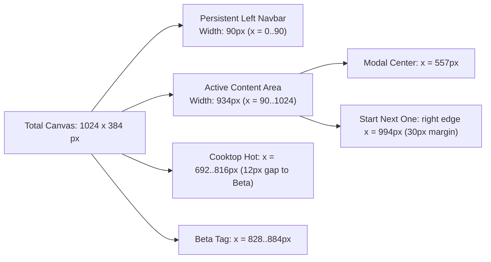
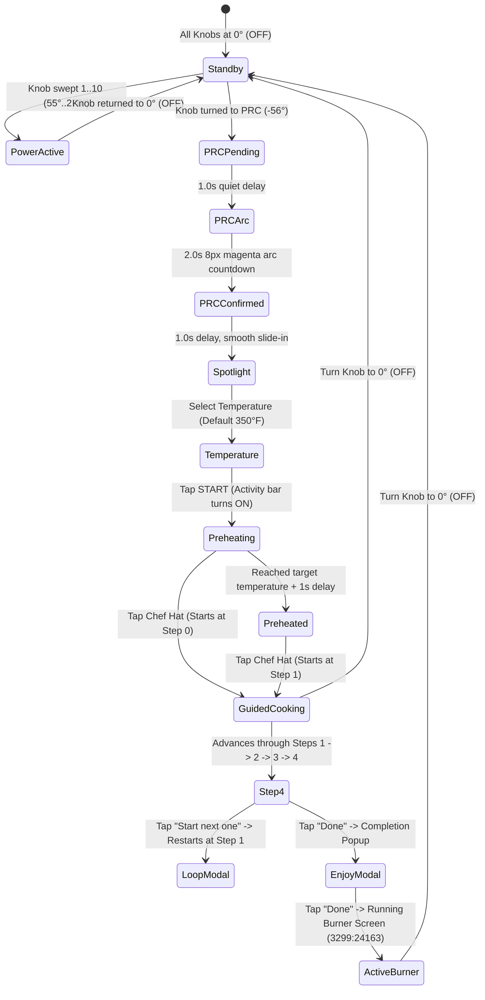

# Polaris Cooktop Precision Cooking Prototype — Master Reference & Architecture Record

> [!IMPORTANT]
> **Source of Truth for Current & Future Sessions**  
> This document records every design token, screen coordinate, knob detent, state transition, and user decision made throughout the Polaris Cooktop Precision Cooking prototype. Future sessions load this state directly without needing to search transcript history.

---

## 1. Environment & Live Access Endpoints

| Endpoint | Target URL / Address | Notes |
| :--- | :--- | :--- |
| **Live Web Tunnel (Global)** | `https://e48738366e84c57c-4-53-66-82.serveousercontent.com/?task=3#task3` | Persistent SSH reverse tunnel for remote testing outside lab Wi-Fi |
| **Local iPad / Lab Wi-Fi** | `http://10.35.123.196:8080/?task=3#task3` | Zero-latency connection for physical iPad Pro 13" in research lab |
| **Local Machine** | `http://localhost:8080/?task=3#task3` | Local HTTP server (`python3 -m http.server 8080`) |
| **Chrome DevTools (CDP)** | `http://127.0.0.1:9245` | Headless Chrome remote debugging port for automated verification |
| **Git Repository** | `https://github.com/ShulanKuang/polaris-cooktop-precision-cooking.git` | Synced on branch `main` |
| **Active Asset Cache Buster** | `?v=20261119-scroll-knobs` | Attached to `styles.css` and `app.js` in `index.html` to defeat Safari caching |

---

## 2. Figma Node Mapping & Design Source of Truth

| Component / Screen | Figma URL / Node ID | Specification & Key Coordinates |
| :--- | :--- | :--- |
| **Pancakes Guided Cooking Section** | [Section `3436:25475`](https://www.figma.com/design/9Pcrjaycs7PhYgxEaGC9Fj/Polaris-Prototype?node-id=3436-25475) | Complete 5-step guided cooking sequence (Cards 0 to 4) |
| **Pancakes Guided Cooking Start** | [Node `3321:34955`](https://www.figma.com/design/9Pcrjaycs7PhYgxEaGC9Fj/Polaris-Prototype?node-id=3321-34955) | Guided cooking landing card layout |
| **Chef Hat Launch Button** | [Node `3345:37922`](https://www.figma.com/design/9Pcrjaycs7PhYgxEaGC9Fj/Polaris-Prototype?node-id=3345-37922) & `3320:34573` | Trigger icon on Pancakes tile (active in preheating & preheated) |
| **Disabled Action Button** | [Node `3321:34971`](https://www.figma.com/design/9Pcrjaycs7PhYgxEaGC9Fj/Polaris-Prototype?node-id=3321-34971) | `rgba(255, 255, 255, 0.45)` text on `#2a2b30` dark background |
| **Loop Modal ("Ready for another?")** | [Node `3330:37455`](https://www.figma.com/design/9Pcrjaycs7PhYgxEaGC9Fj/Polaris-Prototype?node-id=3330-37455) | 625px card, centered at $x = 557\text{px}$ in 934px content area |
| **Completion Modal ("Enjoy!")** | [Node `3451:25661` & `3451:25773`](https://www.figma.com/design/9Pcrjaycs7PhYgxEaGC9Fj/Polaris-Prototype?node-id=3451-25773&t=fbWvFYuwgbyAF8RH-11) | 625px card, centered at $x = 557\text{px}$; 266px height with 33px balanced bottom spacing |
| **Active Burner Running Screen** | [Node `3299:24163`](https://www.figma.com/design/9Pcrjaycs7PhYgxEaGC9Fj/Polaris-Prototype?node-id=3299-24163) | Destination when tapping "Done" on Enjoy modal |
| **Cooktop Hot Status Indicator** | [Node `2323:15134`](https://www.figma.com/design/9Pcrjaycs7PhYgxEaGC9Fj/Polaris-Prototype?node-id=2323-15134) & `2315:14060` | $124 \times 23\text{px}$ red pill, exactly **12px to the left of Beta icon** |
| **Temperature Landing Screen** | `Task3B-PCTemperature` | Default landing temperature set to **350°F** |

---

## 3. Geometric Architecture & Alignment Rules



1. **Persistent Navbar Offset**:
   - Left navbar occupies $x = 0 \dots 90\text{px}$.
   - All guided cooking screens (`#t3ScreenGuidedCooking`) are offset by `left: 90px; width: 934px;` so content never slips behind the navbar.
2. **Modal Backdrop & Centering**:
   - `.t3-guided-modal-backdrop` is set to `left: 0; width: 100%;` inside the 934px content container.
   - The 625px modal card centers at $x = 557\text{px}$ (`90 + 934 / 2`), matching the visual center between the navbar and the right screen edge.
3. **"Start next one" Button Alignment**:
   - Right edge is locked to $x = 994\text{px}$, exactly **30px away from the 1024px screen right edge**.
   - Single-row layout (`white-space: nowrap`) with 16px font size.
4. **"Cooktop Hot" Status Indicator**:
   - Top status bar: $y = 12\text{px}$.
   - Positioned at $x = 692\text{px} \dots 816\text{px}$ ($124 \times 23\text{px}$).
   - Beta icon starts at $x = 828\text{px}$.
   - Gap between Cooktop Hot right edge and Beta icon left edge: **12px exactly**.
   - Dynamically appears whenever any burner is active; cleanly hides when all burners are OFF.
5. **Persistent Step Numbers**:
   - Step numbers `1`, `2`, `3`, `4` are direct children of `.t3-guided-card` (`.t3-guided-card-num`), positioned at `left: 21px; top: 21px;`.
   - Never hidden when cards are inactive.
   - On Steps 2 and 3, number sits at left ($x = 21\text{px}$) while the dark-themed `"Start timer"` button sits on the right ($x = \text{right } 21\text{px}$) with an 85px gap.

---

## 4. Hardware Manifold & Knob State Machine



### Core Hardware Metaphor Rules:
- **Knobs Never Auto-Turn Off**: Knobs represent physical brass dials and only reset when explicitly turned or tapped by the user back to $0^\circ$ (OFF).
- **Physical Knob Shuts Down Guided Cooking**: Turning the active burner's physical knob back to $0^\circ$ while in Guided Cooking immediately turns off the burner, cancels all active timers, deactivates the activity bar, and smoothly returns to `3-start`.

---

## 5. Chronological Decision & Bugfix History

1. **Task 3B Landing Temperature**: Set default landing temperature on the horizontal picker to **350°F** (`app.js:2078`).
2. **Dual-State Chef Hat Launch**: Expanded click target for Chef Hat icon (Figma `3345:37922` & `3320:34573`) so it responds during preheat (starts at Card 0) and after preheat completion (starts at Card 1).
3. **Single Exit Button**: Eliminated duplicate overlapping exit buttons; unified into a single `< Cooktop` exit control at $x = 90\text{px}$.
4. **Dark Start Timer Button**: Set timer trigger button on active cards to dark charcoal (`#303238`), matching typography tokens.
5. **Single-Row "Start next one" Button**: Reduced font size to 16px with `white-space: nowrap`, and aligned right edge exactly 30px from screen right edge (`x = 994px`).
6. **Content Area Offset**: Anchored all guided cooking containers to $x = 90\text{px}$ to prevent any overlap with the persistent left navbar.
7. **Centered Guided Modals**: Removed redundant `left: 90px` inside container already offset by 90px; shifted modal cards 90px to the left so both "Ready to make another pancake?" and "Enjoy!" modals center at $x = 557\text{px}$.
8. **Disabled Button Styling**: Styled `"Preheating..."` and `"Cooking..."` action buttons during active countdown with `#2a2b30` background and `rgba(255, 255, 255, 0.45)` muted text.
9. **Return to Active Burner from Enjoy**: Tapping "Done" on Enjoy popup cleanly returns to the active burner screen (Figma `3299:24163`).
10. **Cooktop Hot Indicator in Status Bar**: Positioned at $x = 692\text{px} \dots 816\text{px}$, creating an exact 12px gap to the Beta icon ($x = 828\text{px}$) across all screens when any burner is active.
11. **Step Numbers Visibility**: Moved `.t3-guided-card-num` out of `.t3-guided-card-header-row` into direct children of `.t3-guided-card` so numbers 1, 2, 3, 4 remain visible across inactive states.
12. **Rear-Left Burner Decoupled from Task Completion**: Fixed bug where rear-left burner (`tStartActiveBurner1`) remained stuck on after finishing all tasks and turning off all knobs. In `showT3Screen("start")`, removed the unconditional `setKnobAngle(2, -56)` override. `tStartActiveBurner1` visibility is now strictly determined by physical Knob 2 state (`Math.abs(knobsState[1].angle) > 12`). When all knobs are turned to 0° (or `finishGuidedCookingAndTurnOff` is triggered), `state.task3Mode` is reset to `"temp"`, `state.task3IsRunning = false`, and all active burner cards are hidden.
13. **Status Bar Single-Source Architecture (Eliminated Double Status Bars)**: Fixed overlapping double status bar glitch. Background screens (`task3a-start-burners.png`, `beef_bg_clean_burner.png`, `3299_24045_clean.png`, `3299_24163_clean.png`, `guided_clean_bg.png`) already contain baked-in status bar artwork. Live DOM `#topStatus` is now restricted exclusively to screens without baked artwork (`pancakesDoneness`, `pancakesBurner`, `pancakesCookware`). The `#cooktopHotIndicator` was decoupled into an independent overlay element positioned at `left: 692px; top: 12px; z-index: 760;`, allowing it to indicate active heat dynamically without triggering a duplicate status bar.
14. **Horizontal Scrollable Step-by-Step Cards**: Made guided cooking step-by-step cards horizontally scrollable across desktop mouse drag and native iPad touch gestures.
   - Container `#t3GuidedViewport` at `left: 296px; top: 92px; width: 638px; height: 188px; overflow-x: auto; overflow-y: hidden; -webkit-overflow-scrolling: touch; touch-action: pan-x; cursor: grab; scrollbar-width: none;`.
   - Card track `.t3-guided-cards-track` styled with `position: relative; left: 0; width: max-content; padding-right: 64px; transform: none !important;` to eliminate transform vs scroll coordinate collision.
   - Dynamic width expansion (active card 350px, collapsed cards 80px, `flex-shrink: 0;`).
   - Auto-scroll synchronization (`scrollGuidedCardIntoView(step, smooth)`) ensures selected card always centers/scrolls smoothly into the visible viewport.
   - Gesture vs tap disambiguation (`hasCardDragged` threshold > 4px) ensures fluid swiping on iPad/touch/mouse never inadvertently selects or activates cards.
15. **Universal Responsive Knob Control Across Any Sequence**:
   - Independent manifold architecture: Physical Knobs 1 through 5 operate as independent dials without interference.
   - Flow cancellation vs Burner Isolation: Turning off the active precision cooking knob during setup (`temperature`, `selectCookware`, `spotlight`, `beefMenu`, `foodOptions`, `pancakes`, `preheat`) or guided cooking (`3C-guidedCooking`) cancels that specific flow and returns to `3-start` with that burner OFF, but *never* shuts down or zeroes out other running burners.
   - Multi-burner concurrency: Operating any knob (1..5) while in any screen updates that burner's level, roller translateY, active ring, Cooktop Hot status indicator (12px left of Beta), and activity glow strip.
   - Synchronized roller state: `syncAllT3RollersWithKnobs()` reconciles physical knob angles and roller positions across screen switches. Turning all knobs to 0° completely shuts off all 5 burners, indicators, and the activity strip.
16. **iPad Touch Scroll & Gesture Lockdown Fix**:
   - **Root Cause Identified**:
     1. Document-level `touchmove` listener in `initGestureLockdown()` was intercepting and calling `e.preventDefault()` on all touch moves outside a hardcoded whitelist (`.t3-picker-track`, etc.). This completely cancelled native WebKit touch scrolling on iPad for `#t3GuidedViewport` and other scrollable containers.
     2. In CSS-scaled environments (`transform: scale(var(--app-scale, 0.8146))` for iPad Pro 13" 1:1 physical mode), WebKit native momentum scrolling lacks direct touch tracking when parent gestures are constrained. `setupGuidedCardsScroll()` previously only tracked `mousemove` without adjusting `scrollLeft` on `touchmove`.
     3. Aggressive Safari caching prevented new JS/CSS bundles from taking effect on iPad without incremented cache buster query parameters.
   - **Resolution**:
     - Expanded `initGestureLockdown()` with explicit scrollable selectors (`.t3-guided-cards-viewport`, `.t3-guided-cards-track`, `.t3-guided-card`, `.t3-cookware-carousel-viewport`, `.t3-pancakes-cards-carousel`, etc.) AND added a dynamic computed style traversal check: any element with `overflow-x/y: auto/scroll` and `scrollWidth/Height > clientWidth/Height` is automatically permitted to scroll natively.
     - Added unified touch/mouse inertia drag physics to `setupGuidedCardsScroll()`: tracks `touchstart`, `touchmove`, and `touchend` with `--app-scale` compensation (`diff / scale`), real-time `scrollLeft` updates, momentum velocity decay loop (`friction = 0.94`, `requestAnimationFrame`), and an 80ms tap cooldown to prevent inadvertent card clicks during a swipe gesture.
     - Removed conflicting `scroll-behavior: smooth;` from `.t3-guided-cards-viewport` CSS so real-time touch tracking is crisp and 1:1 on glass without animation lag.
     - Bumped asset version cache busters in `index.html` to `?v=20261120-ipad-scroll-fix`.
17. **Scroll-Driven Active Step Expansion & Centering Alignment**:
   - **Requirement**: As step cards scroll horizontally (via touch drag on iPad Pro, mouse drag on desktop, or trackpad wheel), whichever card is moved to the center of the screen / primary action button automatically expands to its 350px active state showing instructions and timer controls, while non-centered cards collapse to 80px summary cards, rather than requiring the user to tap to expand.
   - **Root Cause & Geometry Analysis**:
     - In `.t3-guided-cards-track`, collapsed cards are 80px wide with a 12px gap (92px pitch).
     - Expanded cards are 350px wide. The primary action button center is aligned with the active card at canonical scroll offsets:
       - Step 1: `scrollLeft = 0px`
       - Step 2: `scrollLeft = 92px`
       - Step 3: `scrollLeft = 184px`
       - Step 4: `scrollLeft = 276px`
     - Measuring dynamic `getBoundingClientRect()` of transitioning cards caused severe hysteresis because an expanded 350px card had an asymmetrical attraction basin against 80px collapsed cards. At Step 2, Card 1's collapsed center in the track (40px) could never physically reach the button center in the viewport (171px) because `scrollLeft` clamped at 0.
   - **Resolution**:
     - Implemented exact slot midpoint thresholding in `checkAndExpandCenterCard()`:
       - Step 1: `scrollLeft < 46px`
       - Step 2: `46px <= scrollLeft < 138px`
       - Step 3: `138px <= scrollLeft < 230px`
       - Step 4: `scrollLeft >= 230px`
     - Enables completely fluid, bidirectional scrolling: dragging forward smoothly expands 1 $\to$ 2 $\to$ 3 $\to$ 4; dragging backward smoothly expands 4 $\to$ 3 $\to$ 2 $\to$ 1 with zero jumps, zero jitter, and no boundary locking.
     - On drag end and scroll settle, smoothly snaps (`snapToActiveCard(true)`) to center the active card directly over the action button (`(step - 1) * 92px`).
     - Swipe flick detection (`|velocity| > 0.28`) enables quick flicks to advance or rewind steps with natural momentum.
     - Expanded `.t3-guided-cards-track` `padding-right: 500px;` (from 64px) so Step 4 can freely center over the action button without hitting the track boundary.
     - Updated cache busters in `index.html` to `?v=20261120-center-expand-v2`.
18. **Damped Touch/Mouse Drag Physics & Synchronized 500ms Ease-Out Glide (Smooth Slower Transitions)**:
   - **User Feedback**: "good, but it move to fast, make it slower, so it doesn't feel like it's not responsive", "good, but these cards moved too fast, make them slower, so it doesn't feel like it's not responsive".
   - **Root Cause Analysis**:
     1. **Unweighted Sensitivity & Scale Distortion**: Under `--app-scale: 0.8146`, dividing unscaled delta by 0.8146 amplified physical drag distance by 1.228x. Because card pitch is only 92px, a normal 250px iPad finger swipe traversed over 300px of layout scroll—overshooting all 4 steps in a single stroke.
     2. **Browser Default Snap Rush**: WebKit and Blink's native `scrollTo({ behavior: "smooth" })` over a short 92px distance completes in ~100ms, creating a jarring, near-instantaneous snap.
     3. **Unconstrained Multi-Step Flipping**: Unrestricted momentum decay and high flick sensitivity allowed a single swipe to blow past multiple cooking steps at high velocity.
     4. **Abrupt Card Content Pop**: Expanding card width at 0.4s while content snapped from `display: none` to `display: flex` caused text and timer buttons to pop in jarringly.
   - **Resolution**:
     - **Tactile Drag Weighting (`DRAG_FACTOR = 0.60`)**: Applied a deliberate 0.60 damping factor to scaled drag movements (`scaledDiff = (diff / scale) * 0.60`), requiring ~150px of natural touch travel on iPad to traverse one 92px card slot.
     - **1-Step Per Gesture Pagination Constraint**: Clamped active drag scroll travel to `[dragStartStep - 1, dragStartStep + 1]` with soft rubber-band resistance beyond boundaries (`(delta) * 0.25`). Each swipe gesture advances or rewinds by at most 1 step, ensuring the user never accidentally skips a cooking instruction.
     - **Custom 500ms `easeOutCubic` Smooth Scroll Loop (`smoothScrollGuidedViewport`)**: Replaced browser `scrollTo({ behavior: "smooth" })` with a synchronized RequestAnimationFrame animation loop utilizing `easeOutCubic: 1 - Math.pow(1 - progress, 3)` over 500ms. Applies to swipe release snaps, direct card taps, and "Next Step" button clicks.
     - **Synchronized CSS Card Expansion**: Slowed `.t3-guided-card` CSS width transition to `0.5s cubic-bezier(0.25, 1, 0.5, 1)`, perfectly matching the 500ms scroll glide.
     - **Content Fade-In Animation**: Added `@keyframes t3CardFadeIn` (`opacity: 0 -> 1`, `translateY: 3px -> 0` over `0.35s ease-out`) for `.t3-guided-card.is-active .t3-guided-card-body` and `.t3-guided-card-header-row`, creating a graceful visual reveal of cooking instructions and timer controls.
     - **Scroll Event Loop Guard**: Added `isSmoothScrolling` flag so native `scroll` event listeners do not fire competing settle timers during programmatic glide animations.
     - **Updated Cache Busters**: Bumped `index.html` link and script tags to `?v=20261120-slower-scroll`.
19. **Pancakes Guided Cooking Card Overlap on Pancake Art (Eliminated Artificial Left Cutoff)**:
   - **User Request**: "these card should not be cutoff, it should be overlap on the pancake image."
   - **Root Cause & Figma Geometry Analysis**:
     - In Figma Section `3436:25475` (Frames `3321:35633`, `3321:35808`, `3321:36584`, `3321:36716`):
       - Screen width is 1024px. The left navigation rail occupies $x = 0\dots 90\text{px}$. The `#t3ScreenGuidedCooking` content area starts at $x = 90\text{px}$ (`width: 934px`).
       - The pancake illustration (`pancakes_light_golden`) is positioned at screen $x = 114\text{px}$, $y = 137\text{px}$, width = 228px (spanning $x_{\text{rel}} = 24\dots 252\text{px}$ inside `#t3ScreenGuidedCooking`).
       - In Figma:
         - **Step 1**: Card 1 is active (350px) at $x_{\text{rel}} = 296\text{px}$ (just right of the pancake image).
         - **Step 2**: Card 1 collapses to 80px and slides left to $x_{\text{rel}} = 204\dots 284\text{px}$, directly OVERLAPPING the right side of the pancake image.
         - **Step 3**: Card 1 slides further left to $x_{\text{rel}} = 112\dots 192\text{px}$ and Card 2 sits at $x_{\text{rel}} = 204\dots 284\text{px}$, BOTH cards overlapping the pancake image.
         - **Step 4**: Card 1 sits at $x_{\text{rel}} = 20\dots 100\text{px}$, Card 2 at $x_{\text{rel}} = 112\dots 192\text{px}$, Card 3 at $x_{\text{rel}} = 204\dots 284\text{px}$, ALL THREE cards overlapping the pancake image.
       - Each collapsed card features glassmorphism styling (`backdrop-filter: blur(30px); background: rgba(97, 100, 107, 0.2); border: 1px solid rgba(204, 204, 202, 0.3)`), allowing the golden pancake art to show through with frosted translucence.
     - **The Defect**:
       - `.t3-guided-cards-viewport` was previously configured with `left: 296px; width: 638px; overflow-x: auto;`.
       - Because the scroll container began at $x = 296\text{px}$, any card scrolled to the left of $296\text{px}$ was clipped by the container boundary, creating a harsh artificial cutoff line right next to the pancake and making previous step cards disappear completely.
   - **Resolution**:
     - **Expanded Viewport to Left Rail Edge**: Changed `.t3-guided-cards-viewport` from `left: 296px; width: 638px;` to `left: 0; width: 934px;`, spanning the entire content area from the rail ($x_{\text{screen}} = 90\text{px}$) to the right edge of the screen ($x_{\text{screen}} = 1024\text{px}$).
     - **Padded Track Architecture (`padding-left: 296px;`)**: Added `padding-left: 296px;` to `.t3-guided-cards-track`. In Step 1 (`scrollLeft = 0`), Card 1 rests exactly at $x_{\text{rel}} = 296\text{px}$ (centered over the primary action button at $467\text{px}$), leaving the transparent padding area over the pancake image completely clear and unobstructed.
     - **100% Mathematical & Coordinate Parity**:
       - Step 1: `scrollLeft = 0` $\implies$ Card 1 at $296\text{px}$ (active), center at $471\text{px}$.
       - Step 2: `scrollLeft = 92` $\implies$ Card 1 at $204\text{px}$ (overlaps pancake $24\dots 252\text{px}$), Card 2 at $296\text{px}$ (active), center at $471\text{px}$.
       - Step 3: `scrollLeft = 184` $\implies$ Card 1 at $112\text{px}$, Card 2 at $204\text{px}$ (both overlap pancake), Card 3 at $296\text{px}$ (active), center at $471\text{px}$.
       - Step 4: `scrollLeft = 276` $\implies$ Card 1 at $20\text{px}$, Card 2 at $112\text{px}$, Card 3 at $204\text{px}$ (all 3 overlap pancake without cutoff), Card 4 at $296\text{px}$ (active), center at $471\text{px}$.
       - All existing `scrollLeft` targets (`(step - 1) * 92`), slot thresholds (`< 46`, `46..138`, `138..230`, `>= 230`), drag damping (`DRAG_FACTOR = 0.60`), and 500ms `easeOutCubic` animations remain completely preserved with zero regression.
     - **Zero Button Collisions**: Back button (`#t3GuidedBackBtn` at $y = 0\dots 64\text{px}$, `z-index: 20`) and Exit button (`.t3-guided-exit-btn` at $y = 300\dots 348\text{px}$, `z-index: 15`) remain fully clickable and outside the card viewport Y boundary ($y = 92\dots 280\text{px}$).
     - **Updated Cache Busters**: Bumped `index.html` link and script tags to `?v=20261120-overlap-pancake`.
20. **Precision Cooking Activation on Active Burner Status Screen (2s Circular Arc Countdown & Dynamic Burner Isolation)**:
   - **User Request**: "after I finished the 500deg on rear left burrner, then turn on the precision cooking for the front left one, it didn't show the circular 2s count down and start on precision cooking screen. Fix it."
   - **Root Cause Analysis**:
     1. **Strict Stage Guard in Knob Handler**: In `app.js` (`updateT3BurnerFromKnob`), the PRC detection block checked `if ((targetIndex === 1 || targetIndex === 2 || targetIndex === 4 || targetIndex === 5) && t3Stage === "start")`. When Rear Left finished preheating, `t3Stage` was `"burnerStatus"`, so turning Knob 1 (Front Left) to PRC was completely ignored.
     2. **Active Precision Knob Index Hardcoding**: `activePrcKnobIndex` was only assigned when `t3Stage === "start"`, leaving it stuck on Knob 2.
     3. **Mode Inversion on Transition**: `transitionToT3Temperature()` contained a legacy override: `if (t3Stage === "burnerStatus") state.task3Mode = "food";`, which erroneously pushed the user into food selection instead of the Precision Cooking temperature screen (`3B-temperature`).
     4. **Cancellation Flow Destructive Fallback**: `cancelT3A()` unconditionally set `t3Stage = "start"` and revealed `els.t3ScreenStart`, wiping out any actively running burners (such as Rear Left at 500°F).
     5. **Shared State Variable Clobbering**: Both burners previously shared a single `state.task3TargetTemp`. Changing Knob 1 to default 350°F overwrote Rear Left's 500°F setting.
     6. **Partial Reset in `resetT3BurnerToOff`**: `resetT3BurnerToOff` only targeted the `#t3ScreenStart` roller DOM elements, failing to reset status screen rollers (`#t3StatusBurnerRoller1`), leaving faint dashed borders and selected item styling.
   - **Resolution**:
     1. **Dual Stage Burner Activation (`(t3Stage === "start" || t3Stage === "burnerStatus")`)**: Updated `updateT3BurnerFromKnob` so any precision burner (1, 2, 4, 5) can trigger its 2-second circular countdown arc and transition while on `burnerStatus`.
     2. **Dynamic Active Knob Binding**: `activePrcKnobIndex = index;` is updated dynamically on both `"start"` and `"burnerStatus"`.
     3. **Per-Burner Target Temperature Tracking (`t3BurnerTargetTemps`)**: Added independent tracking (`t3BurnerTargetTemps = { 1: 350, 2: 350, 4: 350, 5: 350 }`). Setting Front Left to 350°F leaves Rear Left at 500°F completely intact.
     4. **Smooth Slide Transition from Burner Status**: `transitionToT3Temperature()` now determines `outgoingScreen` dynamically (`els.t3ScreenBurnerStatus` vs `els.t3ScreenStart`) and slides smoothly to `els.t3ScreenTemperature` with Front Left active and the "Temperature" tab pre-selected in `#t3SideDrawerTemp`.
     5. **Context-Aware Cancellation & Slide-Back**: In `cancelT3A()`, if Rear Left is still running (`isRearLeftActive`), clicking `< Precision Cooking` (`#t3BtnBackFromTemp`) smoothly slides back to `els.t3ScreenBurnerStatus` and restores `activePrcKnobIndex = 2` without interrupting Rear Left's 500°F run. If Rear Left is off, it slides back to `els.t3ScreenStart`.
     6. **Universal Roller Reset (`getT3Rollers`)**: Refactored `resetT3BurnerToOff` to iterate through all matching DOM rollers across start and status screens, cleanly stripping all active, prc, arc, and confirmed classes and resetting the strip translateY to base offset.
     7. **All Knobs Off Cleanup**: Turning Knob 2 to OFF returns cleanly to `3-start` with all burners shut off, Cooktop Hot indicator removed, and activity bar deactivated.
     8. **Cache Buster**: Bumped `index.html` script tag to `?v=20261120-prc-arc-fix`.
21. **Pagination Removal on Doneness & Cookware Screens + Strict Z-Index Hierarchy (Left Panel & Caret Buttons Strictly Above All Selection Cards)**:
   - **User Request**: "tkae out the paginate on select doneness screen and cookware slection screen. and the left panel including the caret button should above all slection cards, shouldn't be covered"
   - **Root Cause Analysis**:
     1. **Pagination Dots Across Selection Screens**:
        - Standalone Cookware Selection (`#t3ScreenSelectCookware`): Included `#t3CookwarePagination` (`.t3-cookware-pagination`) with 3 dots between the carousel viewport and the "Select" button.
        - Beef Doneness Screens (`#t3ScreenBeefDoneness` and `#t3ScreenBeefCook`): Included `#t3DonenessPagination` (`.t3-doneness-pagination`) and `#t3BeefDonenessDots` (`.t3-beef-carousel-dots`) with 5 dots positioned between the steak cards and the START button.
        - Pancakes Flow Screens (`#t3ScreenPancakes`): Both Doneness view (`#t3PancakesDonenessDots`) and Cookware view (`#t3PancakesCookwareDots`) rendered `.t3-pancakes-pagination` dots above their respective START buttons.
     2. **Layering Inversion & Clipping on Left Navigation Drawers**:
        - On Pancakes Mode (`#t3ScreenPancakes`):
          - The left collapsible drawer (`.t3-drawer-collapsible`) contains the pinned header with the caret back button (`.t3-drawer-back-btn` with `< Burners | Pancakes`), 4 option tiles, and the drawer handle (`.t3-drawer-handle` at width 37px spanning $x = 353\dots 390\text{px}$).
          - Previously, `.t3-pancakes-right-pane` had `z-index: 50;` while `.t3-drawer-collapsible` had `z-index: 25;`. In the $x = 353\dots 390\text{px}$ overlap zone, selection cards (such as "Stainless Steel" or "Cast Iron") painted directly over the drawer handle bar and caret button.
          - During touch scrolling, swiping, or dragging, active/adjacent cards clipped or covered the left panel's handle and caret back button.
        - On Select Cookware Screen (`#t3ScreenSelectCookware`):
          - `.t3-back-btn` (`#t3BtnBackFromCookware`) had `z-index: 30;` overriding its earlier `z-index: 102;`, placing it underneath `.t3-cookware-main-content` (`z-index: 50;`) and `.t3-cookware-carousel-viewport` (`z-index: 50;`).
        - On Beef Screens (`#t3ScreenBeefDoneness`, `#t3ScreenBeefType`, `#t3ScreenBeefThickness`):
          - `.t3-drawer-collapsible` had `z-index: 25;`, risking card overlap against `.t3-beef-doneness-main`.
   - **Resolution**:
     1. **Complete Pagination Removal**:
        - Applied `display: none !important;` to `.t3-cookware-pagination`, `.t3-doneness-pagination`, `.t3-pancakes-pagination`, and `.t3-beef-carousel-dots`.
        - Verified that all existing JavaScript dot update routines (`updatePaginationDots`, `updateDots`, scroll snap listeners) safely handle hidden dots without throwing exceptions.
        - Balanced vertical spacing:
          - Increased `.t3-doneness-footer` `margin-top` from `10px` to `22px` to center the START and Info toggle buttons comfortably in the 384px height.
          - Added `margin-top: 14px;` to `.t3-pancakes-start-btn` to preserve optical centering in both Pancakes Doneness and Cookware views.
     2. **Strict Z-Index Hierarchy (Left Panel & Caret Buttons on Top)**:
        - **Collapsible Left Drawer**: Elevated `.t3-drawer-collapsible` to `z-index: 100;`.
        - **Opaque Backdrop**: Updated `.t3-drawer-content` background to `rgba(22, 23, 26, 0.98); backdrop-filter: blur(24px); -webkit-backdrop-filter: blur(24px);`.
        - **Pinned Header & Caret Back Button**: Set `.t3-drawer-pinned-header` to `z-index: 120;` and `.t3-drawer-back-btn` to `position: relative; z-index: 120;`.
        - **Drawer Right Handle Bar**: Elevated `.t3-drawer-handle` to `z-index: 101;`, guaranteeing that cards passing beneath ($x = 353\dots 390\text{px}$) slide cleanly behind the handle and its `<` caret.
        - **Back Button Global Rule**: Enforced `.t3-back-btn { z-index: 120 !important; }` across all screens.
        - **Side Drawer Navigation**: Elevated `.pc-side-drawer-nav` to `z-index: 100;`.
        - **Right Panes & Carousels Layered Below**: Reduced `.t3-pancakes-right-pane`, `.t3-cookware-main-content`, `.t3-cookware-carousel-viewport`, `.t3-beef-doneness-main`, `.t3-beef-type-main`, and `.t3-beef-thickness-main` to `z-index: 20;`.
     3. **Cache Buster**:
        - Bumped stylesheet link in `index.html` to `?v=20261123-no-pagination-panel-above`.
     4. **Verification via Chrome CDP**:
        - Automated script `scripts/verify_pagination_and_panel_layering.mjs` verified:
          - `#t3ScreenSelectCookware`: pagination `display: none`, back button `z-index: 120`, nav drawer `z-index: 100`, main content `z-index: 20`.
          - `#t3ScreenBeefDoneness`: pagination `display: none`, drawer `z-index: 100`, pinned header `z-index: 120`, back button `z-index: 120`, handle `z-index: 101`, main content `z-index: 20`.
          - `#t3ScreenPancakes` (Doneness view): pagination `display: none`, drawer `z-index: 100`, handle `z-index: 101`, right pane `z-index: 20`.
          - `#t3ScreenPancakes` (Cookware view): pagination `display: none`, drawer `z-index: 100`, right pane `z-index: 20`, handle bar cleanly over "Stainless Steel" card.
          - High-resolution visual screenshots saved: `verify_cookware_no_pagination.png`, `verify_beef_doneness_no_pagination.png`, `verify_pancakes_doneness_panel_above.png`, `verify_pancakes_cookware_panel_above.png`.

### 22. Enjoy Modal Done Button Bottom Spacing & Guided Cooking Timer End Sound Notifications (November 23, 2026)
- **Figma Reference**:
  - [Node `3451:25773` & `3451:25661`](https://www.figma.com/design/9Pcrjaycs7PhYgxEaGC9Fj/Polaris-Prototype?node-id=3451-25773&t=fbWvFYuwgbyAF8RH-11): Completion Dialog Popup ("Enjoy! Use the knob to turn off the burner.")
  - [Section `3436:25475` & Nodes `3321:35808`, `3321:36584`](https://www.figma.com/design/9Pcrjaycs7PhYgxEaGC9Fj/Polaris-Prototype?node-id=3436-25475): Step 2 (3-minute timer) and Step 3 (1-minute timer) inside-card countdowns.
- **Problem Statement**:
  1. **Done Button Spacing in Enjoy Modal**:
     - The "Enjoy! Use the knob to turn off the burner." dialog card (`.t3-guided-modal-card.is-done-modal`) previously had `height: 220px; justify-content: center; gap: 28px;`.
     - With a 2-line heading (font-size 32px, line-height 1.25 -> 80px), 28px gap, and 48px high "Done" button, total content height was 156px.
     - Inside a 220px card with 32px top padding and 24px bottom padding, flex alignment left only ~8px of clearance between the bottom edge of the Done button and the bottom edge of the card, creating an uncomfortable, cramped visual appearance.
  2. **Timer End Sound Notifications**:
     - Guided cooking for Pancakes has two active countdown timers:
       - **Step 2 (Cook Side 1)**: 3-minute timer ("Pour batter. Cook for 3 mins.").
       - **Step 3 (Cook Side 2)**: 1-minute timer ("Flip pancake. Cook for 1 minute.").
     - Previously, the timer only triggered a generic UI click (`playSound("toggleOn")`), with no audible appliance notification chime to alert the user that the timer had finished.
     - In addition, Step 3 had static text copied from a mid-countdown mockup (`0:35:00` / 35s), rather than starting at 1 minute (`0:59:00` / 60s) like the 3-minute timer (`2:59:00` / 180s).
- **Resolution**:
  1. **Enjoy Modal Card Proportions & Balanced Spacing**:
     - Standardized `.t3-guided-modal-card.is-done-modal` to `height: 266px;` (matching the standard Polaris modal card height).
     - Configured `padding: 36px 32px 36px 32px;`, `justify-content: center;`, `align-items: center;`, and `gap: 32px;`.
     - Resulting geometry (verified via Chrome CDP):
       - Card height: 266px (216.68px in scaled viewport).
       - Top space from card edge to heading text: **33px**.
       - Middle gap between heading text and Done button: **32px**.
       - Bottom space from Done button to card bottom edge: **33px** (increased from 8px to 33px!).
       - The Done button now sits gracefully with equal, balanced breathing room above and below.
  2. **1-Minute Timer Initialization & Consistency**:
     - Updated Step 3 timer in `index.html` and `app.js` (`setGuidedStep`) to initialize to `0:59:00` (1-minute countdown, matching Step 2's `2:59:00`).
     - Set `totalSeconds = 59` for Step 3 in `startGuidedTimer` so it counts down properly from 1 minute.
  3. **Appliance Chime Sound Notification (`sounds/TimerChime.wav` & Web Audio API)**:
     - Generated high-fidelity 44.1kHz 16-bit PCM kitchen appliance chime `./sounds/TimerChime.wav` featuring a pleasant, melodic two-tone ascending chime sequence:
       - Pair 1: A5 (880 Hz) -> D6 (1174.66 Hz) with smooth bell harmonics (octave & overtone) and exponential decay.
       - Pause: 150ms.
       - Pair 2: A5 (880 Hz) -> D6 (1174.66 Hz) with lingering resonance.
     - Registered `timerEnd: "./sounds/TimerChime.wav"` in `SOUND_FILES`, automatically preloading and decoding into Web Audio buffer cache.
     - Implemented `playTimerNotificationSound()` with direct Web Audio API synthesized synthesis fallback for 100% offline and immediate latency-free playback.
     - Wired `playTimerNotificationSound()` to trigger automatically when `progress >= 1.0` (when timer reaches 0) for both:
       - Step 2 (3-minute timer completion).
       - Step 3 (1-minute timer completion).
  4. **Cache Busting**:
     - Updated `styles.css?v=20261123-enjoy-modal-chime` and `app.js?v=20261123-enjoy-modal-chime` in `index.html`.
  5. **Verification via Chrome CDP**:
     - Automated test script confirmed:
       - Modal card measurements: top distance = 33px, middle gap = 32px, bottom distance = 33px.
       - Step 2 timer countdown from `2:59:00` to completion triggers `playTimerNotificationSound()` at $t = 0$.
       - Step 3 timer countdown from `0:59:00` to completion triggers `playTimerNotificationSound()` at $t = 0$.
       - Clicking "Done" on Enjoy modal dismisses cleanly and transitions back to the preheat-reached burner state.
     - Captured and archived screenshots:
       - `verify_enjoy_modal_spacing.png`
       - `verify_enjoy_modal_dismissed.png`
       - `verify_step2_timer_running.png`
       - `verify_step2_timer_completed.png`
       - `verify_step3_timer_running.png`
       - `verify_step3_timer_completed.png`

### 23. Omni-Stage & Arbitrary Sequence Knob Turn-Off
- **Date**: 2026-11-23
- **Context & Issue**:
  - During usability research tests, participants finish cooking at different stages and in unpredictable sequences. Specifically at the end of the test when both Rear Left (500°F on Knob 2) and Front Left (Pancakes Guided Cooking on Knob 1) are active:
    - Researchers and participants may turn off **Rear Left first**, then **Front Left second** (Sequence A).
    - Or turn off **Front Left first**, then **Rear Left second** (Sequence B).
    - Or turn off knobs during earlier stages such as Pancakes Preheat, Food Burner Status, Cookware/Doneness setup, or Temp Run.
  - Previously, `finishGuidedCookingAndTurnOff()` unconditionally redirected to `3-start` ignoring whether Rear Left was still actively cooking at 500°F. In addition, turning off non-active knobs while on certain screens failed to reset roller DOM classes or play turn-off audio feedback, leading to inconsistent burner states on screen.
- **Resolution**:
  1. **Dual-Burner Awareness in Guided Cooking & Preheat Turn-Off**:
     - In both `finishGuidedCookingAndTurnOff()` and `updateT3BurnerFromKnob()` (`pancakesPreheat`, `preheat`, `foodPreheat`, `techniquePreheat`):
       - Checked whether Rear Left (Knob 2) is active:
         ```javascript
         const isRearLeftActive = Boolean(
           (knobsState[1] && Math.abs(knobsState[1].angle) > 12) ||
           currentT3BurnerLevels[2] === "prc" ||
           (typeof currentT3BurnerLevels[2] === "number" && currentT3BurnerLevels[2] > 0)
         );
         ```
       - If Rear Left **is active**:
         - Retain `activePrcKnobIndex = 2`.
         - Keep active burner card (`#tStartActiveBurner1`) visible showing Rear Left target temperature (e.g. 500°F).
         - Transition screen to `3-burnerStatus`, where Rear Left displays live 500°F running status while Front Left roller (`t3StatusBurnerRoller1`) cleanly displays "OFF" (inactive).
       - If Rear Left **is already off**:
         - Set `activePrcKnobIndex = null`.
         - Hide `#tStartActiveBurner1`.
         - Transition screen directly to `3-start` with ALL burners showing OFF.
  2. **Rear-Left-First Turn-Off Handling**:
     - When Knob 2 is turned to OFF while Front Left is in Guided Cooking (Step 1-4, Enjoy modal, or preheat):
       - In `updateT3BurnerFromKnob()` (`else if (isOff)`):
         - Cleanly set `currentT3BurnerLevels[2] = "off"`.
         - Call `resetT3BurnerToOff(2)` to reset roller strip position and remove active/confirmed/prc classes.
         - Hide `#tStartActiveBurner1`.
         - Play `playSound("toggleOff")`.
         - Guided cooking for Front Left continues uninterrupted.
       - When Knob 1 is subsequently turned to OFF:
         - `finishGuidedCookingAndTurnOff()` detects `isRearLeftActive` is false.
         - Clears timers, hides Enjoy/Next modals, resets Knob 1 roller to OFF, and transitions to `3-start`.
         - Screen shows **ALL burners OFF** (`#tStartActiveBurner1` hidden, all rollers at "OFF", activity bar hidden, hot indicator hidden).
  3. **Front-Left-First Turn-Off Handling**:
     - When Knob 1 is turned to OFF while Rear Left is still cooking:
       - `finishGuidedCookingAndTurnOff()` detects `isRearLeftActive` is true.
       - Clears timers, hides modals, resets Knob 1 roller to OFF, and transitions to `3-burnerStatus`.
       - Screen displays Rear Left running at 500°F and Front Left roller as "OFF".
       - Activity bar and Cooktop Hot indicator remain visible.
     - When Knob 2 is subsequently turned to OFF from `3-burnerStatus`:
       - `updateT3BurnerFromKnob()` cleanly turns off Knob 2, resets its roller, hides `#tStartActiveBurner1`, and transitions to `3-start`.
       - Screen shows **ALL burners OFF** (`#tStartActiveBurner1` hidden, all rollers at "OFF", activity bar hidden, hot indicator hidden).
  4. **Multi-Stage & Food Burner Status Turn-Off**:
     - Updated `updateFoodBurnerStatusDisplay()` to invoke `resetT3BurnerToOff(1)` and `resetT3BurnerToOff(2)`.
     - Turning off Knob 1 displays Front Left OFF badge (`#t3FoodBurnerOffFL`).
     - Turning off Knob 2 displays Rear Left OFF badge (`#t3FoodBurnerOffRL`).
     - Turning off both cleanly transitions back to `3-start` with activity bar off.
     - Updated `else if (isOff)` in `updateT3BurnerFromKnob()` to check `allOff` and automatically transition from `burnerStatus`, `foodBurnerStatus`, or `tempRun` to `3-start` when every knob is at 0°.
  5. **Verification via Automated CDP Suite (`scripts/verify_knob_turn_off_sequences.mjs`)**:
     - **Sequence 1 (Rear Left first, then Front Left)**: Passed. Verified Rear Left turns off while Enjoy modal stays active; turning off Front Left transitions to `3-start` with all burners OFF.
     - **Sequence 2 (Front Left first, then Rear Left)**: Passed. Verified Front Left turn-off transitions to `3-burnerStatus` showing 500°F Rear Left active and Front Left roller OFF; turning off Rear Left transitions to `3-start` with all burners OFF.
     - **Sequence 3 (Pancakes Preheat turn-off)**: Passed. Verified Knob 1 turn-off transitions to `3-burnerStatus`, subsequent Knob 2 turn-off transitions to `3-start`.
     - **Sequence 4 (Food Burner Status turn-off)**: Passed. Verified individual burner OFF badges and clean transition to `3-start` with activity bar hidden when both are off.
     - Screenshots captured and archived:
       - `verify_turn_off_seq1_rear_off_first.png`
       - `verify_turn_off_seq1_all_off.png`
       - `verify_turn_off_seq2_front_off_first.png`
       - `verify_turn_off_seq2_all_off.png`


