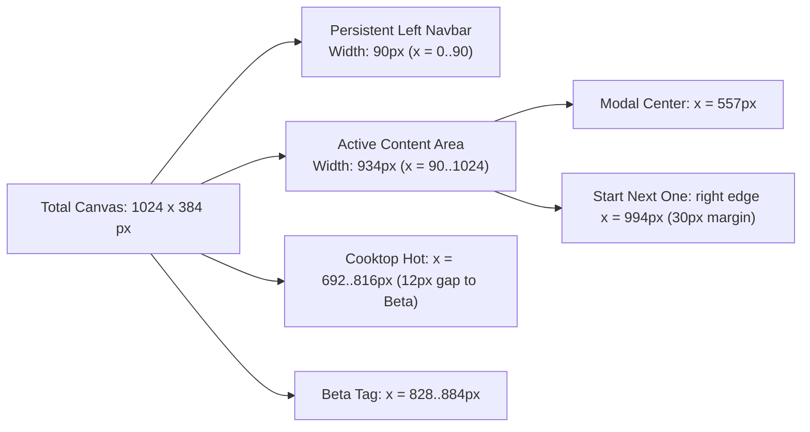
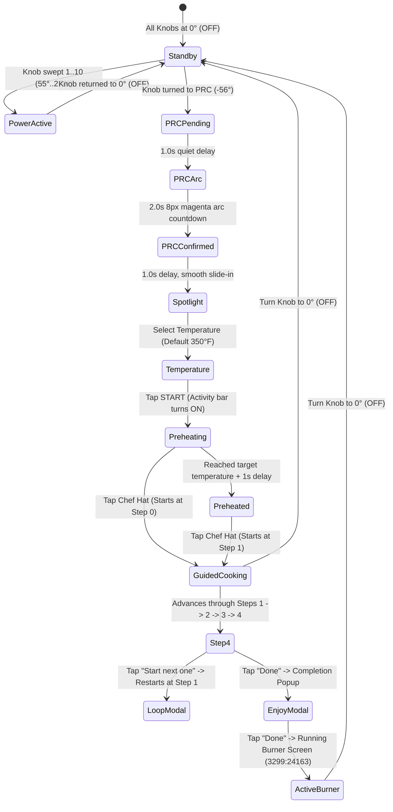

# Polaris Cooktop Precision Cooking Prototype — Master Reference & Architecture Record

> [!IMPORTANT]
> **Source of Truth for Current & Future Sessions**  
> This document records every design token, screen coordinate, knob detent, state transition, and user decision made throughout the Polaris Cooktop Precision Cooking prototype. Future sessions load this state directly without needing to search transcript history.

---

## 1. Environment & Live Access Endpoints

| Endpoint | Target URL / Address | Notes |
| :--- | :--- | :--- |
| **Live Web Tunnel (Global)** | `https://e48738366e84c57c-4-53-66-82.serveousercontent.com/?task=3#task3` | Persistent SSH reverse tunnel for remote testing outside lab Wi-Fi |
| **Local iPad / Lab Wi-Fi** | `http://10.35.123.196:8080/?task=3#task3` | Zero-latency connection for physical iPad Pro 13" in research lab |
| **Local Machine** | `http://localhost:8080/?task=3#task3` | Local HTTP server (`python3 -m http.server 8080`) |
| **Chrome DevTools (CDP)** | `http://127.0.0.1:9245` | Headless Chrome remote debugging port for automated verification |
| **Git Repository** | `https://github.com/ShulanKuang/polaris-cooktop-precision-cooking.git` | Synced on branch `main` |
| **Active Asset Cache Buster** | `?v=20261119-scroll-knobs` | Attached to `styles.css` and `app.js` in `index.html` to defeat Safari caching |

---

## 2. Figma Node Mapping & Design Source of Truth

| Component / Screen | Figma URL / Node ID | Specification & Key Coordinates |
| :--- | :--- | :--- |
| **Pancakes Guided Cooking Section** | [Section `3436:25475`](https://www.figma.com/design/9Pcrjaycs7PhYgxEaGC9Fj/Polaris-Prototype?node-id=3436-25475) | Complete 5-step guided cooking sequence (Cards 0 to 4) |
| **Pancakes Guided Cooking Start** | [Node `3321:34955`](https://www.figma.com/design/9Pcrjaycs7PhYgxEaGC9Fj/Polaris-Prototype?node-id=3321-34955) | Guided cooking landing card layout |
| **Chef Hat Launch Button** | [Node `3345:37922`](https://www.figma.com/design/9Pcrjaycs7PhYgxEaGC9Fj/Polaris-Prototype?node-id=3345-37922) & `3320:34573` | Trigger icon on Pancakes tile (active in preheating & preheated) |
| **Disabled Action Button** | [Node `3321:34971`](https://www.figma.com/design/9Pcrjaycs7PhYgxEaGC9Fj/Polaris-Prototype?node-id=3321-34971) | `rgba(255, 255, 255, 0.45)` text on `#2a2b30` dark background |
| **Loop Modal ("Ready for another?")** | [Node `3330:37455`](https://www.figma.com/design/9Pcrjaycs7PhYgxEaGC9Fj/Polaris-Prototype?node-id=3330-37455) | 625px card, centered at $x = 557\text{px}$ in 934px content area |
| **Completion Modal ("Enjoy!")** | [Node `3451:25661`](https://www.figma.com/design/9Pcrjaycs7PhYgxEaGC9Fj/Polaris-Prototype?node-id=3451-25661) | 625px card, centered at $x = 557\text{px}$; directs knob turn-off |
| **Active Burner Running Screen** | [Node `3299:24163`](https://www.figma.com/design/9Pcrjaycs7PhYgxEaGC9Fj/Polaris-Prototype?node-id=3299-24163) | Destination when tapping "Done" on Enjoy modal |
| **Cooktop Hot Status Indicator** | [Node `2323:15134`](https://www.figma.com/design/9Pcrjaycs7PhYgxEaGC9Fj/Polaris-Prototype?node-id=2323-15134) & `2315:14060` | $124 \times 23\text{px}$ red pill, exactly **12px to the left of Beta icon** |
| **Temperature Landing Screen** | `Task3B-PCTemperature` | Default landing temperature set to **350°F** |

---

## 3. Geometric Architecture & Alignment Rules

1. **Persistent Navbar Offset**:
   - Left navbar occupies $x = 0 \dots 90\text{px}$.
   - All guided cooking screens (`#t3ScreenGuidedCooking`) are offset by `left: 90px; width: 934px;` so content never slips behind the navbar.
2. **Modal Backdrop & Centering**:
   - `.t3-guided-modal-backdrop` is set to `left: 0; width: 100%;` inside the 934px content container.
   - The 625px modal card centers at $x = 557\text{px}$ (`90 + 934 / 2`), matching the visual center between the navbar and the right screen edge.
3. **"Start next one" Button Alignment**:
   - Right edge is locked to $x = 994\text{px}$, exactly **30px away from the 1024px screen right edge**.
   - Single-row layout (`white-space: nowrap`) with 16px font size.
4. **"Cooktop Hot" Status Indicator**:
   - Top status bar: $y = 12\text{px}$.
   - Positioned at $x = 692\text{px} \dots 816\text{px}$ ($124 \times 23\text{px}$).
   - Beta icon starts at $x = 828\text{px}$.
   - Gap between Cooktop Hot right edge and Beta icon left edge: **12px exactly**.
   - Dynamically appears whenever any burner is active; cleanly hides when all burners are OFF.
5. **Persistent Step Numbers**:
   - Step numbers `1`, `2`, `3`, `4` are direct children of `.t3-guided-card` (`.t3-guided-card-num`), positioned at `left: 21px; top: 21px;`.
   - Never hidden when cards are inactive.
   - On Steps 2 and 3, number sits at left ($x = 21\text{px}$) while the dark-themed `"Start timer"` button sits on the right ($x = \text{right } 21\text{px}$) with an 85px gap.

---

## 4. Hardware Manifold & Knob State Machine

### Core Hardware Metaphor Rules:
- **Knobs Never Auto-Turn Off**: Knobs represent physical brass dials and only reset when explicitly turned or tapped by the user back to $0^\circ$ (OFF).
- **Physical Knob Shuts Down Guided Cooking**: Turning the active burner's physical knob back to $0^\circ$ while in Guided Cooking immediately turns off the burner, cancels all active timers, deactivates the activity bar, and smoothly returns to `3-start`.

---

## 5. Chronological Decision & Bugfix History

1. **Task 3B Landing Temperature**: Set default landing temperature on the horizontal picker to **350°F** (`app.js:2078`).
2. **Dual-State Chef Hat Launch**: Expanded click target for Chef Hat icon (Figma `3345:37922` & `3320:34573`) so it responds during preheat (starts at Card 0) and after preheat completion (starts at Card 1).
3. **Single Exit Button**: Eliminated duplicate overlapping exit buttons; unified into a single `< Cooktop` exit control at $x = 90\text{px}$.
4. **Dark Start Timer Button**: Set timer trigger button on active cards to dark charcoal (`#303238`), matching typography tokens.
5. **Single-Row "Start next one" Button**: Reduced font size to 16px with `white-space: nowrap`, and aligned right edge exactly 30px from screen right edge (`x = 994px`).
6. **Content Area Offset**: Anchored all guided cooking containers to $x = 90\text{px}$ to prevent any overlap with the persistent left navbar.
7. **Centered Guided Modals**: Removed redundant `left: 90px` inside container already offset by 90px; shifted modal cards 90px to the left so both "Ready to make another pancake?" and "Enjoy!" modals center at $x = 557\text{px}$.
8. **Disabled Button Styling**: Styled `"Preheating..."` and `"Cooking..."` action buttons during active countdown with `#2a2b30` background and `rgba(255, 255, 255, 0.45)` muted text.
9. **Return to Active Burner from Enjoy**: Tapping "Done" on Enjoy popup cleanly returns to the active burner screen (Figma `3299:24163`).
10. **Cooktop Hot Indicator in Status Bar**: Positioned at $x = 692\text{px} \dots 816\text{px}$, creating an exact 12px gap to the Beta icon ($x = 828\text{px}$) across all screens when any burner is active.
11. **Step Numbers Visibility**: Moved `.t3-guided-card-num` out of `.t3-guided-card-header-row` into direct children of `.t3-guided-card` so numbers 1, 2, 3, 4 remain visible across inactive states.
12. **Rear-Left Burner Decoupled from Task Completion**: Fixed bug where rear-left burner (`tStartActiveBurner1`) remained stuck on after finishing all tasks and turning off all knobs. In `showT3Screen("start")`, removed the unconditional `setKnobAngle(2, -56)` override. `tStartActiveBurner1` visibility is now strictly determined by physical Knob 2 state (`Math.abs(knobsState[1].angle) > 12`). When all knobs are turned to 0° (or `finishGuidedCookingAndTurnOff` is triggered), `state.task3Mode` is reset to `"temp"`, `state.task3IsRunning = false`, and all active burner cards are hidden.
13. **Status Bar Single-Source Architecture (Eliminated Double Status Bars)**: Fixed overlapping double status bar glitch. Background screens (`task3a-start-burners.png`, `beef_bg_clean_burner.png`, `3299_24045_clean.png`, `3299_24163_clean.png`, `guided_clean_bg.png`) already contain baked-in status bar artwork. Live DOM `#topStatus` is now restricted exclusively to screens without baked artwork (`pancakesDoneness`, `pancakesBurner`, `pancakesCookware`). The `#cooktopHotIndicator` was decoupled into an independent overlay element positioned at `left: 692px; top: 12px; z-index: 760;`, allowing it to indicate active heat dynamically without triggering a duplicate status bar.
14. **Horizontal Scrollable Step-by-Step Cards**: Made guided cooking step-by-step cards horizontally scrollable across desktop mouse drag and native iPad touch gestures.
   - Container `#t3GuidedViewport` at `left: 296px; top: 92px; width: 638px; height: 188px; overflow-x: auto; overflow-y: hidden; -webkit-overflow-scrolling: touch; touch-action: pan-x; cursor: grab; scrollbar-width: none;`.
   - Card track `.t3-guided-cards-track` styled with `position: relative; left: 0; width: max-content; padding-right: 64px; transform: none !important;` to eliminate transform vs scroll coordinate collision.
   - Dynamic width expansion (active card 350px, collapsed cards 80px, `flex-shrink: 0;`).
   - Auto-scroll synchronization (`scrollGuidedCardIntoView(step, smooth)`) ensures selected card always centers/scrolls smoothly into the visible viewport.
   - Gesture vs tap disambiguation (`hasCardDragged` threshold > 4px) ensures fluid swiping on iPad/touch/mouse never inadvertently selects or activates cards.
15. **Universal Responsive Knob Control Across Any Sequence**:
   - Independent manifold architecture: Physical Knobs 1 through 5 operate as independent dials without interference.
   - Flow cancellation vs Burner Isolation: Turning off the active precision cooking knob during setup (`temperature`, `selectCookware`, `spotlight`, `beefMenu`, `foodOptions`, `pancakes`, `preheat`) or guided cooking (`3C-guidedCooking`) cancels that specific flow and returns to `3-start` with that burner OFF, but *never* shuts down or zeroes out other running burners.
   - Multi-burner concurrency: Operating any knob (1..5) while in any screen updates that burner's level, roller translateY, active ring, Cooktop Hot status indicator (12px left of Beta), and activity glow strip.
   - Synchronized roller state: `syncAllT3RollersWithKnobs()` reconciles physical knob angles and roller positions across screen switches. Turning all knobs to 0° completely shuts off all 5 burners, indicators, and the activity strip.
